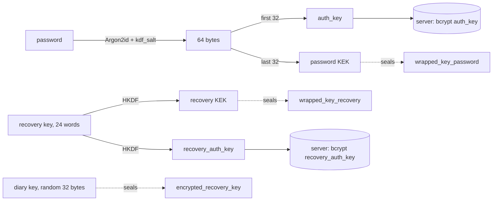
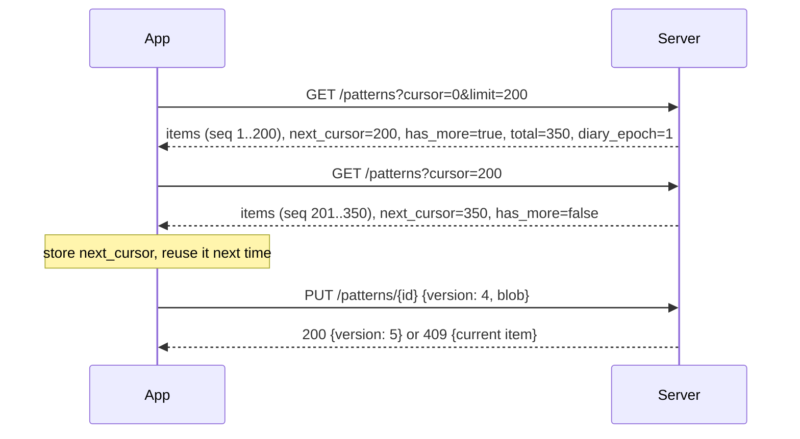

# Lumaely Cloud API

Contract between the app and the cloud server. All bodies are JSON unless stated. Binary fields (`[]byte`) are base64 strings. Protected routes take `Authorization: Bearer <token>`.

## Zero-knowledge keys

The server never sees the password, the recovery key or the diary key. It stores only what it needs to authenticate and the diary key sealed twice.



| Stored on the server | Readable by the server |
|---|---|
| `kdf_salt`, `kdf_params` | yes, public per account |
| bcrypt of `auth_key`, bcrypt of `recovery_auth_key` | no |
| `wrapped_key_password`, `wrapped_key_recovery`, `encrypted_recovery_key` | no |
| entries, patterns, activities, places, folders, bookmark blobs, files | no |
| `entry_timestamp`, `sha256_hash`, `media_type`, file sizes, ids | yes |
| session `device_name`, `platform`, `created_at`, `last_seen_at` | yes |

`kdf_params` is opaque to the server (suggested: `{"alg":"argon2id","m":65536,"t":3,"p":1}`). Wrapped keys are opaque blobs (suggested: XChaCha20-Poly1305, nonce prefixed).

### Key bundle

Returned by register, login, recovery and `GET /users/me/keys`.

```json
{
  "kdf_salt": "base64", "kdf_params": {},
  "wrapped_key_password": "base64",
  "wrapped_key_recovery": "base64",
  "encrypted_recovery_key": "base64"
}
```

## Accounts

| Route | Body | Result |
|---|---|---|
| `POST /users/login/params` | `{email}` | `{kdf_salt, kdf_params}`. Unknown emails get a stable fake salt. |
| `POST /users/register` | `{email, auth_key, recovery_auth_key, kdf_salt, kdf_params, wrapped_key_password, wrapped_key_recovery, encrypted_recovery_key, device?}` | 201 `{token, user, keys}`, 409 email taken |
| `POST /users/login` | `{email, auth_key, device?}` | 200 `{token, user, keys}`, 401 |
| `POST /users/recover/start` | `{email, recovery_auth_key}` | 200 `{recovery_token, wrapped_key_recovery}` (valid 15 min), 401 |
| `POST /users/recover/finish` | `{recovery_token, auth_key, kdf_salt, kdf_params, wrapped_key_password, device?}` | 200 `{token, user, keys}`. Signs out every other device. |
| `GET /users/me` | | `{user_id, email, created_at, diary_epoch}` |
| `GET /users/me/keys` | | key bundle |
| `PUT /users/me/password` | `{current_auth_key, auth_key, kdf_salt, kdf_params, wrapped_key_password, recovery?, sign_out_other_devices}` | 204, 401 wrong current key. `recovery` = `{recovery_auth_key, wrapped_key_recovery, encrypted_recovery_key}` replaces the recovery key. |
| `GET /users/me/sessions` | | 200 list of the account's live sessions, see [Devices](#devices). |
| `DELETE /users/me/sessions` | | 204. Signs out every device, this one included. |
| `DELETE /users/me/sessions/{session_id}` | | 204. Signs out that device, this one allowed. 404 unknown or another account's session, 400 malformed id. |
| `DELETE /users/me/diary` | | 204. Erases entries, patterns, activities, places, folders, bookmarks and files. Keeps the account. Increments `diary_epoch`. |
| `DELETE /users/me` | | 204. Deletes the account and its files. |
| `GET /users/me/storage` | | `{used_bytes, quota_bytes}`. `used_bytes` counts files, not previews. `quota_bytes` is 0 when unlimited. |
| `POST /users/erase/request` | `{email}` | 202 always. Emails a 6-digit code valid 15 min when the account exists. |
| `POST /users/erase/confirm` | `{email, code, device?}` + register key fields | 200 `{token, user, keys}`. Erases the diary, replaces the keys, signs out every device. 401 wrong or expired code; 5 wrong codes burn it. |

### Devices

Register, login, recovery finish and erase confirm each open one session. `device` names it; both fields are optional, at most 64 characters each, else 400.

```json
{"email": "…", "auth_key": "base64", "device": {"name": "Alice's iPhone", "platform": "ios"}}
```

`GET /users/me/sessions` lists non-expired sessions, most recently seen first. `current` marks the caller's session. Missing device fields are `null`.

```json
[
  {"session_id": "uuid", "device_name": "Alice's iPhone", "platform": "ios",
   "created_at": "2026-11-10T09:00:00Z", "last_seen_at": "2026-11-10T18:42:00Z", "current": true},
  {"session_id": "uuid", "device_name": null, "platform": null,
   "created_at": "2026-10-01T12:00:00Z", "last_seen_at": "2026-10-30T08:15:00Z", "current": false}
]
```

`last_seen_at` is refreshed by any authenticated request, at most once every 5 minutes per session.

An account keeps at most 50 live sessions. Each new session deletes expired ones and signs out the least recently seen beyond 50.

Rate limits (per route and client IP, see `TRUSTED_PROXIES`): register, login, login params, recovery and erase routes allow 10 requests per minute, then 429.

The server applies pending database migrations at startup; see README.md.

## Sync model

Every synced item carries `version` (starts at 1, +1 on each change) and `seq` (per-user change counter). Lists return changes after a cursor, oldest first.



List query: `cursor` (default 0), `limit` (1 to 500, default 200). List response:

```json
{"items": [], "next_cursor": 350, "has_more": false, "total": 350, "diary_epoch": 1}
```

- `total` counts the changes after the request's `cursor`, for progress bars.
- Deleted items come back once as tombstones with `deleted_at` set.
- When `diary_epoch` differs from the one the app holds, the diary was reset or erased: drop local data and resync from cursor 0.

## Encrypted resources

`/patterns`, `/activities`, `/places`, `/bookmark-folders`, `/bookmarks` share one shape.

| Route | Body | Result |
|---|---|---|
| `GET /{resource}` | | list response |
| `POST /{resource}` | `{blob}` (+ refs) | 201 item |
| `PUT /{resource}/{id}` | `{version, blob}` (+ refs) | 200 item, 404, 409 `{error, current}` |
| `DELETE /{resource}/{id}` | | 204, 404 |

Item: `{id, blob, version, seq, updated_at, deleted_at?}` (+ refs).

`/bookmarks` refs: `entry_id` (required), `folder_id` (null = Unsorted). Deleting a folder moves its bookmarks to Unsorted. Deleting an entry deletes its bookmarks.

## Entries

### `GET /sync`

List response of entries. Entry: `{entry_id, mood_scale, metadata_blob, entry_timestamp, sha256_hash, version, seq, updated_at, deleted_at?, attachments: [{attachment_id, encrypted_aes_key, media_type, size_bytes, preview_size_bytes, has_preview}]}`. `size_bytes` is the file; `preview_size_bytes` is the preview, 0 when none.

### `POST /sync`

Batch push, `multipart/form-data`, up to 100 operations and 10 files per entry.

- Part `operations`: JSON array.
- File parts: any name, referenced from `operations`.

```json
[
  {"ref": "a", "entry_timestamp": "2026-10-29T00:00:00Z", "sha256_hash": "…",
   "mood_scale": "base64", "metadata_blob": "base64",
   "attachments": [{"file": "f1", "preview": "p1", "encrypted_aes_key": "base64", "media_type": "image/jpeg"}]},
  {"ref": "b", "entry_id": "uuid", "version": 3, "mood_scale": "…", "metadata_blob": "…",
   "entry_timestamp": "…", "sha256_hash": "…"},
  {"ref": "c", "entry_id": "uuid", "deleted": true}
]
```

Omit `entry_id` to create; set it with `version` to update or delete. Each operation commits on its own; the response lists every result.

```json
{"results": [
  {"ref": "a", "status": "created", "entry": {}},
  {"ref": "b", "status": "conflict", "entry": {}},
  {"ref": "c", "status": "deleted"}
]}
```

Statuses: `created`, `updated`, `deleted`, `conflict` (stale `version` or duplicate `sha256_hash`; `entry` is the server copy), `not_found`, `invalid` (includes a preview over 256 KiB or larger than its file), `quota_exceeded`, `error`.

## Files

| Route | Result |
|---|---|
| `GET /attachments/{id}` | File bytes, `Range` supported (206). |
| `GET /attachments/{id}/preview` | Preview bytes, 404 when none. |
| `DELETE /attachments/{id}` | 204. Bumps the entry `version` and `seq`. |

Files count against the account quota (`STORAGE_QUOTA_BYTES`, 5 GiB on Lumaely Cloud, 0 on self-hosted). Previews do not; each is at most 256 KiB and at most the size of its file.

## Other

| Route | Body | Result |
|---|---|---|
| `GET /health` | | `{status, version, mode}`; `mode` is `cloud` or `self-hosted` |
| `POST /feedback` | `{message, contact_email?, app_version?, platform?}` | 201. Optional auth links the user. 10 per minute per IP. |

## Self-hosted (prepared, not implemented)

`SERVER_MODE=self-hosted` turns off email routes and the quota. Accounts can exist without an email (`users.email` nullable) for the coming `lumaely pair` command and `POST /pair`.
