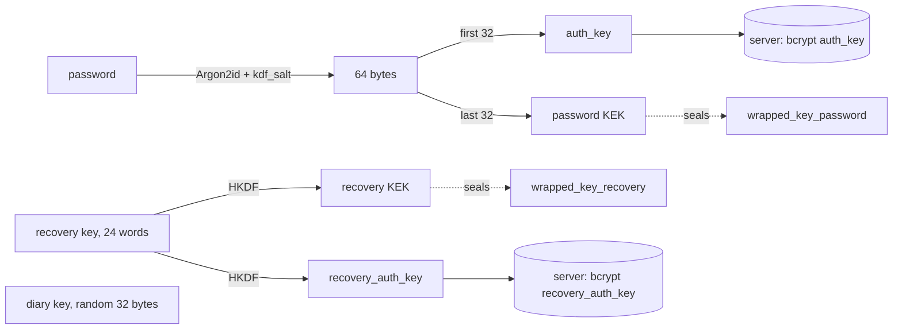
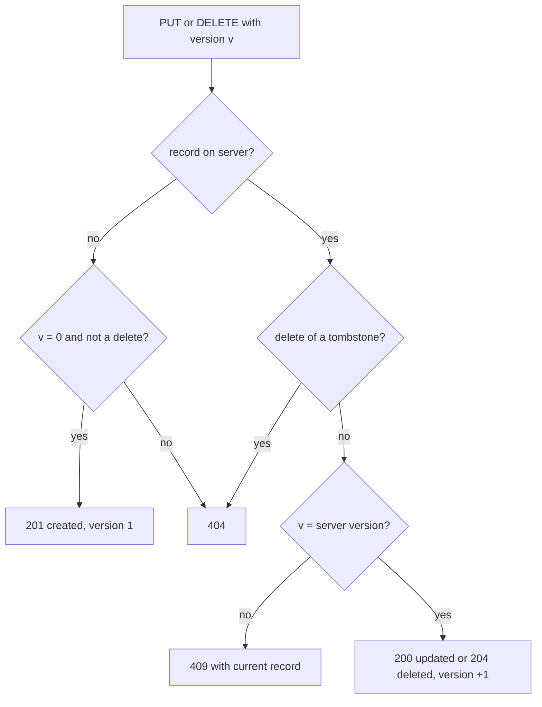

# Lumaely Cloud API

Contract between the app and the cloud server. The machine-readable copy is [openapi.yaml](openapi.yaml); a test keeps its routes equal to the router's. All bodies are JSON unless stated. Binary fields (`[]byte`) are base64 strings. Protected routes take `Authorization: Bearer <token>`.

## Zero-knowledge keys

The server never sees the password, the recovery key or the diary key. It stores only what it needs to authenticate and the diary key sealed twice.



| Stored on the server | Readable by the server |
|---|---|
| `kdf_salt`, `kdf_params` | yes, public per account |
| bcrypt of `auth_key`, bcrypt of `recovery_auth_key` | no |
| `wrapped_key_password`, `wrapped_key_recovery` | no |
| record blobs (days, moods, journal, patterns, places, folders, bookmarks and their links), files, file keys and media types | no |
| collection names, record ids, `version`, `seq`, `updated_at`, file ids, sizes and upload times | yes |
| session `device_name`, `platform`, `created_at`, `last_seen_at` | yes |

`kdf_params` and wrapped keys are opaque to the server; the app's formats are in [Shared conventions](#shared-conventions).

The server never stores the recovery key, not even sealed: a device holding the diary key could otherwise read it and take over the account. A lost recovery key is replaced, not shown again: the app makes a new one and sends it through `PUT /users/me/password` with `recovery`.

### Key bundle

Returned by register, login, recovery and `GET /users/me/keys`.

```json
{
  "kdf_salt": "base64", "kdf_params": {},
  "wrapped_key_password": "base64",
  "wrapped_key_recovery": "base64"
}
```

## Accounts

| Route | Body | Result |
|---|---|---|
| `POST /users/login/params` | `{email}` | `{kdf_salt, kdf_params}`. Unknown emails get a stable fake salt. |
| `POST /users/register/start` | `{email}` | Cloud mode only. 202, also for an address that already has an account: it gets an "already have an account" notice with no code, a new address gets a 6-digit code valid 15 min. A request within 60 s of the last one, or past 10 codes sent to the address in 24 h, sends nothing and keeps that code. 503 `{"error": "Failed to send email"}` when the email fails; retry at once. |
| `POST /users/register` | `{email, code, auth_key, recovery_auth_key, kdf_salt, kdf_params, wrapped_key_password, wrapped_key_recovery, device?}` | 201 `{token, user, keys}`, 409 email taken. Cloud mode: `code` is the emailed sign-up code; 401 when missing, wrong or expired, and 5 wrong codes burn it. Self-hosted: no `code`. |
| `POST /users/login` | `{email, auth_key, device?}` | 200 `{token, user, keys}`, 401 |
| `POST /users/recover/start` | `{email, recovery_auth_key}` | 200 `{recovery_token, wrapped_key_recovery}` (valid 15 min), 401 |
| `POST /users/recover/finish` | `{recovery_token, auth_key, kdf_salt, kdf_params, wrapped_key_password, device?}` | 200 `{token, user, keys}`. Signs out every other device. |
| `GET /users/me` | | `{user_id, email, created_at, diary_epoch}` |
| `GET /users/me/keys` | | key bundle |
| `PUT /users/me/password` | `{current_auth_key, auth_key, kdf_salt, kdf_params, wrapped_key_password, recovery?, sign_out_other_devices}` | 204, 401 wrong current key. `recovery` = `{recovery_auth_key, wrapped_key_recovery}` replaces the recovery key. |
| `GET /users/me/sessions` | | 200 list of the account's live sessions, see [Devices](#devices). |
| `DELETE /users/me/sessions` | | 204. Signs out every device, this one included. |
| `DELETE /users/me/sessions/{session_id}` | | 204. Signs out that device, this one allowed. 404 unknown or another account's session, 400 malformed id. |
| `DELETE /users/me/diary` | | 204. Erases every record and file. Keeps the account. Increments `diary_epoch`. |
| `POST /users/me/delete/request` | | 202. Emails a 6-digit code valid 15 min to the account address. A request within 60 s of the last sent code, or past 10 codes sent in 24 h, sends nothing and keeps that code. 503 `{"error": "Failed to send email"}` when the email fails; retry at once. Cloud mode only. |
| `DELETE /users/me` | `{code}` | 204. Deletes the account and its files. 400 missing code, 401 wrong or expired code; 5 wrong codes burn it. Self-hosted: no body. |
| `GET /users/me/storage` | | `{used_bytes, quota_bytes}`. `used_bytes` counts files, not previews. `quota_bytes` is 0 when unlimited. |
| `POST /users/erase/request` | `{email}` | 202 always, also for an unknown address or a failed email, so the answer never reveals an account. Emails a 6-digit code valid 15 min in the background when the account exists. A request within 60 s of the last sent code, or past 10 codes sent in 24 h, sends nothing and keeps that code. When no email arrives, retry after 60 s. |
| `POST /users/erase/confirm` | `{email, code, device?}` + register key fields | 200 `{token, user, keys}`. Erases the diary, replaces the keys, signs out every device. 401 wrong or expired code; 5 wrong codes burn it. |

Cloud mode emails a plain-text security notice to the account address after a sign-in, password change, recovery key replaced or used, sign-out of all devices, and diary erase. It never blocks the request. Registration, erase, account deletion and single-device sign-out send none.

### Devices

Register, login, recovery finish and erase confirm each open one session. `device` names it; both fields are optional, at most 64 characters each, else 400. The server can read them: send a model name, never the user's name.

```json
{"email": "…", "auth_key": "base64", "device": {"name": "iPhone 15", "platform": "ios"}}
```

`GET /users/me/sessions` lists non-expired sessions, most recently seen first. `current` marks the caller's session. Missing device fields are `null`.

```json
[
  {"session_id": "uuid", "device_name": "iPhone 15", "platform": "ios",
   "created_at": "2026-11-10T09:00:00Z", "last_seen_at": "2026-11-10T18:42:00Z", "current": true},
  {"session_id": "uuid", "device_name": null, "platform": null,
   "created_at": "2026-10-01T12:00:00Z", "last_seen_at": "2026-10-30T08:15:00Z", "current": false}
]
```

`last_seen_at` is refreshed by any authenticated request, at most once every 5 minutes per session.

An account keeps at most 50 live sessions. Each new session deletes expired ones and signs out the least recently seen beyond 50.

Rate limits (per route and client IP, see `TRUSTED_PROXIES`): register start, register, login, login params, recovery and erase routes allow 10 requests per minute, then 429.

The server applies pending database migrations at startup; see README.md.

## Records

Every synced item is a record of one collection: `entries`, `patterns`, `activities`, `places`, `bookmark-folders`, `bookmarks`. The server stores `{collection, id, blob, version, seq, updated_at, deleted_at?}` and never reads the blob.

- **id**: chosen by the app, stored as sent. 64 lowercase hex characters (a day's HMAC id) or a lowercase UUIDv7. Anything else: 400.
- **version**: 1 at creation, +1 on every change, deletes included.
- **seq**: per-user change counter across all collections.
- **blob**: 1 to 256 KiB; empty on a tombstone.

| Route | Body | Result |
|---|---|---|
| `PUT /{collection}/{id}` | `{version, blob}` | 201 created, 200 updated, 409 `{error, current}`, 404, 400 |
| `DELETE /{collection}/{id}?version=N` | | 204, 409 `{error, current}`, 404, 400 |

A write names the version it is based on; the server applies it only if that is still its version:



- `version: 0` means "create; must not exist yet". Two devices creating the same day get one 201 and one 409 with the server copy.
- A tombstone counts as existing: revive a deleted record with a PUT of the tombstone's version.
- A delete never wins over an unseen edit: it gets 409, and the app decides.

## Change feed

### `GET /changes?cursor=&limit=`

Changes of every collection after `cursor`, oldest first. `limit` 1 to 500, default 200.

```json
{"items": [{"collection": "entries", "id": "9f…", "blob": "base64", "version": 3, "seq": 41,
            "updated_at": "2026-10-29T20:31:05Z"}],
 "next_cursor": 41, "has_more": false, "total": 1, "diary_epoch": 1}
```

- `total` counts the changes after the request's `cursor`, for progress bars.
- Deleted records come back once as tombstones with `deleted_at` set.
- When `diary_epoch` differs from the one the app holds, the diary was reset or erased: drop synced state and resync from cursor 0.

### `POST /changes`

Pushes 1 to 100 changes of any collections. Each commits on its own, with the same rules as `PUT` and `DELETE`.

```json
{"changes": [
  {"collection": "entries", "id": "9f…", "version": 0, "blob": "base64"},
  {"collection": "patterns", "id": "0190…", "version": 4, "blob": "base64"},
  {"collection": "bookmarks", "id": "0191…", "version": 2, "deleted": true}
]}
```

```json
{"results": [
  {"collection": "entries", "id": "9f…", "status": "created", "item": {}},
  {"collection": "patterns", "id": "0190…", "status": "conflict", "error": "stale version", "item": {}},
  {"collection": "bookmarks", "id": "0191…", "status": "deleted"}
]}
```

Results follow the request order. Statuses: `created`, `updated`, `deleted`, `conflict` (`item` is the server copy), `not_found`, `invalid`, `error`.

## Files

Files are uploaded on their own and are not linked to records: the day blob lists its attachment ids, with each file's key and media type. The server knows only their ids, sizes and upload times.

| Route | Body | Result |
|---|---|---|
| `PUT /attachments/{id}` | encrypted bytes, `Content-Length` required | 201 `{attachment_id, size_bytes, preview_size_bytes, created_at}`, 409 exists, 411, 413 quota exceeded |
| `PUT /attachments/{id}/preview` | encrypted bytes | 201, 404 no file, 409 preview exists, 413 over 256 KiB, 400 larger than its file when the account has a quota |
| `GET /attachments` | | every file of the account, oldest first |
| `GET /attachments/{id}` | | file bytes, `Range` supported (206) |
| `GET /attachments/{id}/preview` | | preview bytes, 404 when none |
| `DELETE /attachments/{id}` | | 204, 404. Deletes the file and its preview. |

- `id` is a lowercase UUIDv7 chosen by the app. Files and previews are immutable: a retry after a lost response gets 409, which means it is stored.
- The app deletes a day's files when it deletes the day. `GET /attachments` finds files no entry lists any more.
- Files count against the account quota (`STORAGE_QUOTA_BYTES`, 5 GiB on Lumaely Cloud, 0 on self-hosted). Previews do not; each is at most 256 KiB and, when the quota is not 0, at most the size of its file.

## Shared conventions

The server stores what the app sends; both apps must follow these to the bit.

| Item | Convention |
|---|---|
| Id of a day | HMAC-SHA-512-256(id key, `entry:YYYY-MM-DD`), lowercase hex. The id key is derived from the diary key with context `lmy_ids_`. |
| Id of any other record or file | UUIDv7, lowercase text, made by the app |
| Blob | XChaCha20-Poly1305: 24-byte nonce, then ciphertext and tag. Key derived from the diary key with context `lmy_sync`. |
| AAD | `lumaely:<collection>:<id>:<version>`, with the version the record will have once accepted (base version + 1) |
| Payload | JSON with a `v` field (payload format) |
| Key bundle | `kdf_params` = `{"alg":"argon2id","m":65536,"t":3,"p":1}`; wrapped keys are nonce-prefixed XChaCha20-Poly1305 |
| Dates inside blobs | days as `YYYY-MM-DD`; edit times as ISO 8601 UTC with milliseconds |

A day blob, decrypted:

```json
{
  "v": 1,
  "date": "2026-10-29",
  "whole_day": false,
  "journal": {"text": "A nice walk", "updated_at": "2026-10-29T20:31:05.123Z"},
  "moods": [
    {"moment": "morning", "score": 4, "updated_at": "2026-10-29T08:02:11.004Z"},
    {"moment": "evening", "score": 2, "updated_at": "2026-10-29T20:31:05.123Z"}
  ],
  "attachments": [{"id": "0191…", "key": "base64", "media_type": "image/jpeg"}]
}
```

On a 409 the app merges the two copies field by field, using the `updated_at` inside the blob.

## Other

| Route | Body | Result |
|---|---|---|
| `GET /health` | | `{status, version, mode}`; `mode` is `cloud` or `self-hosted` |
| `POST /feedback` | `{message, contact_email?, app_version?, platform?}` | 201. Optional auth links the user. 10 per minute per IP. |

## Self-hosted (prepared, not implemented)

`SERVER_MODE=self-hosted` turns off email routes and the quota. Accounts can exist without an email (`users.email` nullable) for the coming `lumaely pair` command and `POST /pair`.
